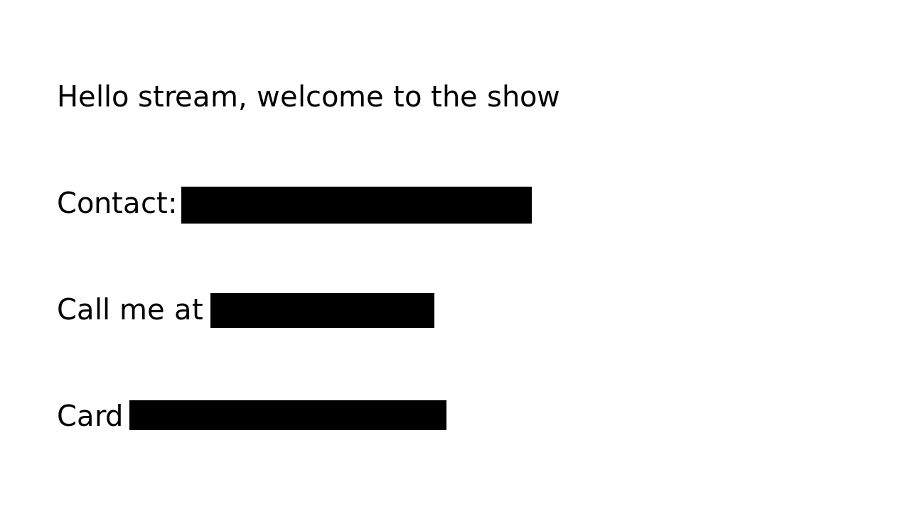

# obs-ytsucks

A project to screen Personal Information from OBS live streams since social media giants such as youtube have draconian stupid rules such as viewing a public website and court document with a phone number in it is "cyberbullying". You can't make this up, but this is how stupid shit has gotten.

**obs-ytsucks** is an OBS Studio plugin (Windows, macOS, Linux) that adds a
**"PII Redaction (OCR)"** video filter. It reads the text in any source
(display/window capture, browser source, media, camera) with OCR, finds
personal information and covers it with a solid box, pixelation or blur
*before* the frame reaches your stream or recording.



## What it detects

| Detector | Examples |
| --- | --- |
| E-mail addresses | `john.doe@example.com`, `jane @ mail.co.uk` (OCR spacing tolerated) |
| Phone numbers | `(555) 123-4567`, `555.123.4567`, `+44 20 7946 0958` |
| Social Security numbers | `123-45-6789`, `SSN: 123456789` (invalid ranges rejected) |
| Payment cards | 13–19 digits, **Luhn-checked** |
| Street addresses | `1600 Pennsylvania Ave NW`, `123 Main St, Apt 4B`, `PO Box 12`, `Springfield, IL 62704` |
| Dates of birth | `DOB: 01/02/1990`, `Date of birth March 3, 1985` |
| Secrets | AWS / GitHub / Slack / Google / Stripe-style keys, **Twitch & YouTube stream keys**, JWTs, private-key headers, `password=...` |
| IP addresses (off by default) | `192.168.1.20`, `fe80::1ff:fe23:4567:890a` |
| Your own keywords | your real name, street, employer… (one per line, case-insensitive) |
| Custom regex | anything else (ECMAScript syntax, one per line) |

Numeric detectors are run on a copy of the text with common OCR mistakes
fixed (`O→0`, `l/I→1`, `S→5`, `B→8`) so `555-l23-4567` is still caught.

## OCR engines

| Platform | Default engine | Extra install |
| --- | --- | --- |
| Windows 10/11 | Windows.Media.Ocr (built into Windows) | none (needs a Windows OCR language, normally already installed) |
| macOS 12+ | Apple Vision | none |
| Linux | Tesseract 5 | `tesseract-ocr` + `tesseract-ocr-eng` |

Tesseract can also be compiled in on Windows/macOS with `-DENABLE_TESSERACT=ON`.

## Usage

1. Right-click a source → **Filters** → **+** → **PII Redaction (OCR)**.
2. Leave the defaults and put some test text on screen; the status line at
   the top of the filter properties shows the engine, scan time and number
   of redactions.
3. Optional: set a **Settings → Hotkeys → "PII Redaction: toggle full
   blackout"** panic key.

Apply the filter to the specific source that might show PII (e.g. the browser
or display capture), or to a nested scene to protect everything inside it.

### Settings

* **Redaction style.** *Solid box* is the default and the only safe choice.
  Pixelation and blur of short text such as numbers can sometimes be reversed.
* **Padding / Keep redaction after text disappears.** These grow boxes and
  keep them up for a while, which hides OCR jitter and scrolling.
* **Minimum time between scans, OCR resolution scale.** Trade CPU for speed.
  A scale of 0.5 is about 4× faster but misses small text.
* **Delay video by N frames (leak protection).** OCR takes time (tens of ms
  with Apple Vision or Windows OCR, 100 ms to 1 s+ with Tesseract), so newly
  shown text is visible until the first scan finds it. With a delay, the
  filter holds frames back and applies the redaction found in later frames
  ("look ahead") before showing them. Use a delay of at least 2 × the scan
  time plus the scan interval: at 30 fps with 300 ms scans and a 200 ms
  interval, that is about 24 frames. Add the same delay to your audio under
  **Advanced Audio Properties → Sync Offset**.
* **Black out frames that have not been scanned yet.** With a delay set,
  any frame that no scan has covered yet is replaced with black, so the
  filter never shows an unscanned frame.
* **Debug outlines.** These draw red rectangles instead of hiding anything.
  Use them only for testing, never live.

> ⚠️ OCR is not perfect. Unusual fonts, tiny or low-contrast text, rotated
> text and fast scrolling can be missed. Treat this filter as one layer of
> protection, use leak protection when it matters, and use OBS's own stream
> delay (Settings → Advanced → Stream Delay) as a last line of defence.

## Building

The project uses the official
[obs-plugintemplate](https://github.com/obsproject/obs-plugintemplate) build
system, and GitHub Actions builds packages for all three platforms
(`.github/workflows`).

### Linux (Ubuntu 24.04)

```bash
sudo apt install build-essential cmake ninja-build pkg-config libobs-dev libsimde-dev libtesseract-dev tesseract-ocr-eng
```

```bash
cmake -S . -B build -G Ninja -DCMAKE_BUILD_TYPE=RelWithDebInfo
```

```bash
cmake --build build
```

Install for the current user (OBS 30+ loads plugins from `~/.config/obs-studio/plugins`):

```bash
P=~/.config/obs-studio/plugins/obs-ytsucks && mkdir -p "$P/bin/64bit" "$P/data" && cp build/obs-ytsucks.so "$P/bin/64bit/" && cp -r data/* "$P/data/"
```

### Windows / macOS

Use the template presets. They download the OBS sources and dependencies for
you:

```bash
cmake --preset windows-x64 && cmake --build --preset windows-x64
```

```bash
cmake --preset macos && cmake --build --preset macos
```

Options: `-DENABLE_TESSERACT=ON/OFF`, `-DENABLE_NATIVE_OCR=ON/OFF`,
`-DBUNDLE_TESSDATA=ON` (downloads `eng.traineddata` into `data/tessdata` so
the plugin carries its own model).

### Tests

```bash
cmake -S tests -B build-tests && cmake --build build-tests && ctest --test-dir build-tests
```

```bash
tests/e2e/run-e2e.sh build
```

The first command runs unit tests for the detectors, box mapping and the
temporal tracker. It needs no OBS. The second runs a headless end-to-end
test on Linux: real libobs + Xvfb, an image with PII, and pixel checks on
the output.

## How it works

```
source ─▶ [filter] render input into ring buffer (delay+1 textures)
              │  every N ms: stage newest frame ─▶ CPU (BGRA)
              │                                     │
              │                     analysis thread ▼
              │        OCR (Vision / WinRT / Tesseract) → words + boxes
              │        PiiMatcher (regex + validators) → rectangles
              │        RegionTracker (persistence, look-ahead)
              ▼
     draw frame from `delay` frames ago + boxes for that frame ─▶ stream
```

Code layout: `src/core` (OBS-independent detection and tracking, unit
tested), `src/ocr` (engine backends), `src/pii-redact-filter.cpp` (the OBS
filter), `data/effects/redact.effect` (pixelate/blur shaders).

## License

GPL-2.0-or-later, the same as OBS Studio.
